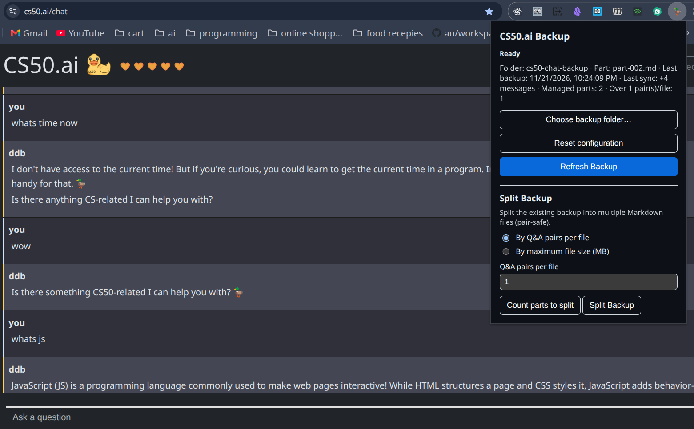

<p align="center">
  <span style="font-size: 120px;">🦆</span>
</p>

<h1 align="center">CS50.ai Local Backup</h1>

<p align="center">
  Chrome extension that saves your <a href="https://cs50.ai/chat">CS50.ai</a> tutor chats to local Markdown — private, searchable, and yours.
</p>

<p align="center">
  
</p>

## Why use it

- **Own your notes** — conversations land as Markdown on your machine (not a cloud-only archive).
- **Incremental sync** — **Refresh Backup** appends only new Q&amp;A; repeats are safe (stable IDs + content hashes).
- **Scales with long courses** — folder mode with `part-001.md`, `part-002.md`, … plus **Split Backup** when parts get large.
- **Readable files** — questions get `### Q1 — short summary` headings; full text stays in the body. See [refresh flow](./docs/refresh-backup-flow.md).
- **CS50-flavored** — duck toolbar icon, built for the Duck debugger chat DOM.

## How to use

### 1. Install the extension

```bash
git clone https://github.com/akhileshu/cs50-ai-local-backup.git
cd cs50-ai-local-backup
npm install
npm run build
```

In Chrome: `chrome://extensions` → **Developer mode** → **Load unpacked** → choose `dist/chrome-mv3`.

### 2. Pick a backup folder

1. Open [cs50.ai/chat](https://cs50.ai/chat) and sign in.
2. Click the 🦆 extension icon → **Choose backup folder…**
3. A small picker window stays open while you select your folder (e.g. `cs50-chat-backup`). The toolbar popup may close during the system dialog — that is expected.
4. Choose the folder named **`cs50-chat-backup`** (optional marker: run `npm run ensure-backup-folder` in this repo to create it elsewhere).

### 3. Refresh backup

With a chat tab open, open the popup and click **Refresh Backup**. Status shows **Ready** when configured; the button flashes green on success.

### 4. Split (optional)

When you have many parts, use **Count parts to split**, then **Split Backup** — by Q&amp;A pairs per file or max MB. Split is separate from refresh; refresh only appends new messages to the active part.

## Features at a glance

| Feature | What it does |
|--------|----------------|
| **Refresh Backup** | Pull new messages from the page → append to local Markdown |
| **Folder mode** | `manifest.json` + managed `part-NNN.md` files |
| **Split Backup** | Re-chunk oversized or crowded parts without losing Q/A pairing |
| **Gap fill** | Older missing turns (full-corpus mode) go under `## Chronological gap fill` |
| **Tail sync** | With the default active-part flag, refresh checks the latest question in the current part so Q1–Q3 in older parts are not duplicated |

Details: [docs/refresh-backup-flow.md](./docs/refresh-backup-flow.md)

## Development

| Command | Purpose |
|---------|---------|
| `npm run dev` | Watch build |
| `npm run build` | Output `dist/chrome-mv3` |
| `npm test` | Vitest (sync, split, manifest) |
| `npm run generate-icons` | Regenerate 🦆 PNG sizes |
| `npm run diagnose` | Extension + page checks (needs display for Playwright) |

## Technical notes

- **Stack:** WXT, TypeScript, Manifest V3, File System Access API, IndexedDB for handles.
- **Extraction:** `#ddbChatText`, `.ddbChat-User` / `.ddbChat-Duck` — see [DOM_FINDINGS.md](./DOM_FINDINGS.md).

## License

Use and adapt for personal CS50 study backups. Not affiliated with Harvard / CS50.