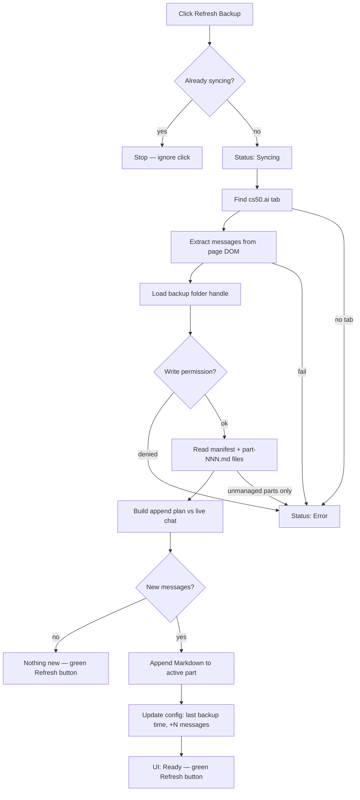
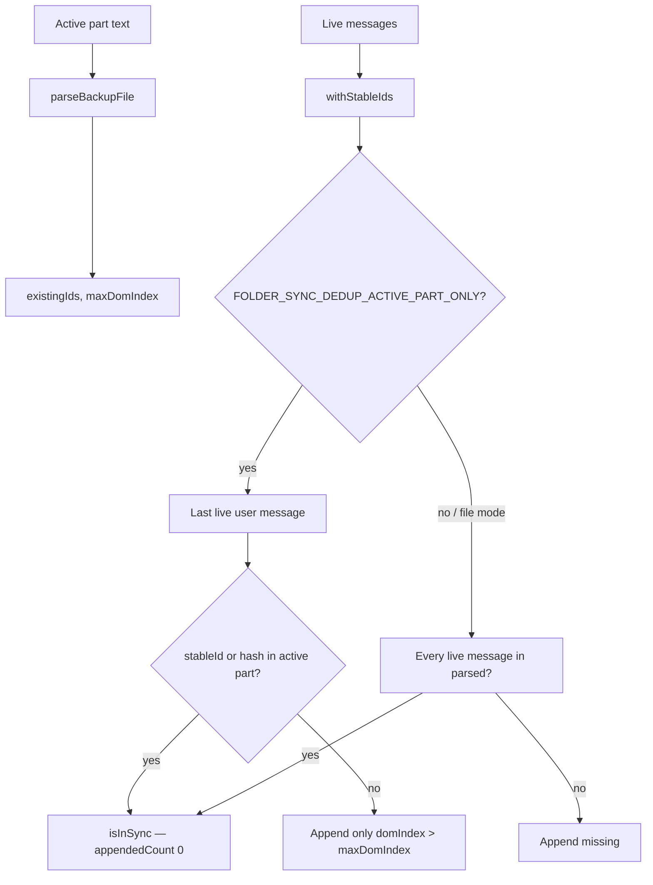
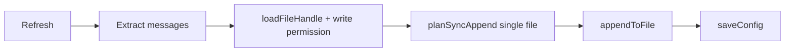

# Refresh Backup & `isInSync`

What happens when you click **Refresh Backup** in the extension popup, and how the extension decides the backup already matches the live chat.

**Split Backup** is a separate action — refresh only appends new chat messages; it does not resize or re-chunk parts.

There is no exported symbol named `isInSync` today; the same decision is made inside `planFolderSync` / `planSyncAppend` when `missing.length === 0` (equivalently `appendedCount === 0`).

## Prerequisites

```text
┌─────────────────────────────────────────┐
│ Backup folder chosen (cs50-chat-backup) │
│ Write access granted (prompt on click)  │
│ Logged in at https://cs50.ai/chat       │
└─────────────────────────────────────────┘
```

## High-level (folder mode — usual path)



## Step-by-step

| Step | Where | What |
|------|--------|------|
| 1 | `popup/main.ts` → `refreshBackup()` | Sets `syncing`, disables Refresh |
| 2 | `findCs50Tab()` | Uses active tab if `cs50.ai`, else finds a `/chat` tab |
| 3 | `extractMessagesFromTab()` | Injects content script if needed; `EXTRACT_MESSAGES` |
| 4 | `content.js` | Scrapes chat DOM → ordered messages + stable ids |
| 5 | `loadDirHandle()` + `ensureDirWriteAccess()` | File System Access API on `cs50-chat-backup/` |
| 6 | `scanManagedBackup()` | Ensures `manifest.json` owns `part-*.md` (blocks orphan-only folders) |
| 7 | `resolveActivePartFileName()` + read active part (or all parts if flag off) | Text used for isInSync / append plan |
| 8 | `planFolderSync()` | Diff live vs backup by **stable id** and **content hash** |
| 9a | `appendedCount === 0` | No disk writes; optional `lastNewCount: 0` |
| 9b | else `appendOrCreatePart()` | Appends Q/A Markdown to active `part-NNN.md` only |
| 10 | `saveConfig()` | `lastBackupIso`, `lastNewCount`, `activePart` |
| 11 | `renderFromConfig()` | Status + meta line in popup |

## How “new” messages are detected

```text
  Live chat (cs50.ai)                Backup on disk
  ───────────────────                ────────────────
  each message: stableId, hash  ──►  parse all part-*.md
                                     collect known ids + hashes

  missing = live messages not in backup
            (by id OR hash)

  ├─ domIndex >= last backed index  → append in order to active part
  └─ domIndex < last backed index   → "gap fill" section (older holes)
```

Logic lives in `utils/sync-engine.ts` (`planFolderSync`, `planSyncAppend`).

## `isInSync` — is the backup already complete?

**Meaning:** refresh can skip disk writes when nothing new needs appending.

**Folder + active-part flag (default):** parse only **part-004.md**. **isInSync** ⇔ the **latest live question** is already in that part (`isFolderTailInSync`). Q1–Q3 in older parts are ignored on purpose — they are not re-copied into the active part.

**Folder, flag off:** parse every part; **isInSync** when every live message matches by id/hash in the full corpus.

**File mode:** single-file `parseBackupFile` + every-message check (below).



### Predicate (conceptual)

```text
File mode / full corpus:
  isInSync ⇔ ∀ m in live: id or contentHash in parsed

Folder + active-part only:
  isInSync ⇔ isFolderTailInSync(live, activePartParsed)
           ⇔ latest live question’s stableId/hash in active part

  if ¬isInSync:
    missing = live messages where domIndex > active.maxDomIndex
              and id/hash not in active part
    (no gap-fill for holes before the tail)

  ⇔  plan.appendedCount === 0 when in sync
```

`stableId` is the page message id when present; otherwise `hash-{role}-{domIndex}-{contentHash}` (`utils/content-hash.ts`).

### What `isInSync` does **not** mean

| Case | `isInSync`? | Why |
|------|-------------|-----|
| Live chat grew (new turns) | false | New stableId + hash not in backup |
| Same chat, second refresh | true | Idempotent — test: “is idempotent on second sync” |
| Message edited on site, **same id** | true | Id still in `existingIds` (content drift not re-backed) |
| Hole: old domIndex missing from backup | false | Missing message → gap-fill path on refresh |
| Empty backup, non-empty chat | false | Nothing in `existingIds` / `existingHashes` yet |
| Q1–Q3 only in part-001…003, Q4 in part-004, live Q1–Q4 | true (flag on) | Tail rule: last live Q4 is in active part — no duplicate Q1–Q3 |
| New Q5 after Q4 in active part | false | domIndex > maxDomIndex → append Q5 (+ A5) only |

### Where it shows up in Refresh

```text
refreshBackup()
  …
  plan = planFolderSync(...) or planSyncAppend(...)
  │
  ├─ isInSync  (appendedCount === 0)
  │     → saveConfig({ lastNewCount: 0 }) optional
  │     → no appendOrCreatePart / appendToFile
  │     → green Refresh button, status stays Ready
  │
  └─ ¬isInSync
        → build Markdown for missing only
        → write active part (folder) or file
        → saveConfig(lastBackupIso, lastNewCount, …)
```

`isInSync` is computed on every refresh; it is **not** cached in `chrome.storage` and there is **no** background poll (MVP).

### File vs folder

| Mode | Parse step | Same `isInSync` rule? |
|------|------------|------------------------|
| Folder | `parseBackupFile(activePart)` if flag on, else `parseBackupCorpus` | Same id/hash rule on whichever parse ran |
| File | `parseBackupFile(existing)` | Yes |

### Code map

```text
utils/parse-backup.ts    parseBackupFile, parseBackupCorpus → existingIds, existingHashes
utils/extractor.ts       withStableIds
utils/sync-engine.ts     missing filter → isInSync ⇔ appendedCount === 0
utils/sync-engine.test.ts  idempotent second sync (appendedCount === 0)
```

## File-mode (legacy single `.md`)

If config is **file** mode instead of folder:



## Errors you might see

| Message | Meaning |
|---------|---------|
| Open cs50.ai/chat… | No suitable tab |
| Cannot talk to cs50.ai page | Reload chat tab; content script dead |
| Could not get write access | Allow permission or re-pick folder |
| Part files exist but not in manifest | Run **Count parts to split** (registers parts) first |
| Wrong backup folder name | Pick `cs50-chat-backup` |

## Code map

```text
popup/main.ts          refreshBackup()
    ├─ tab-extract.ts    extractMessagesFromTab()
    ├─ file-storage.ts   scan, read parts, appendOrCreatePart, saveConfig
    └─ sync-engine.ts    planFolderSync() / planSyncAppend()
entrypoints/content    EXTRACT_MESSAGES handler
```

## Feedback

- **Green** Refresh button (~5s): success (including “nothing new”).
- **Red** Refresh: error; status line shows detail.
- Split panel is **not** involved in refresh.